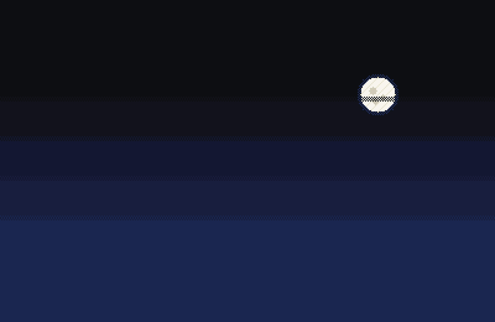
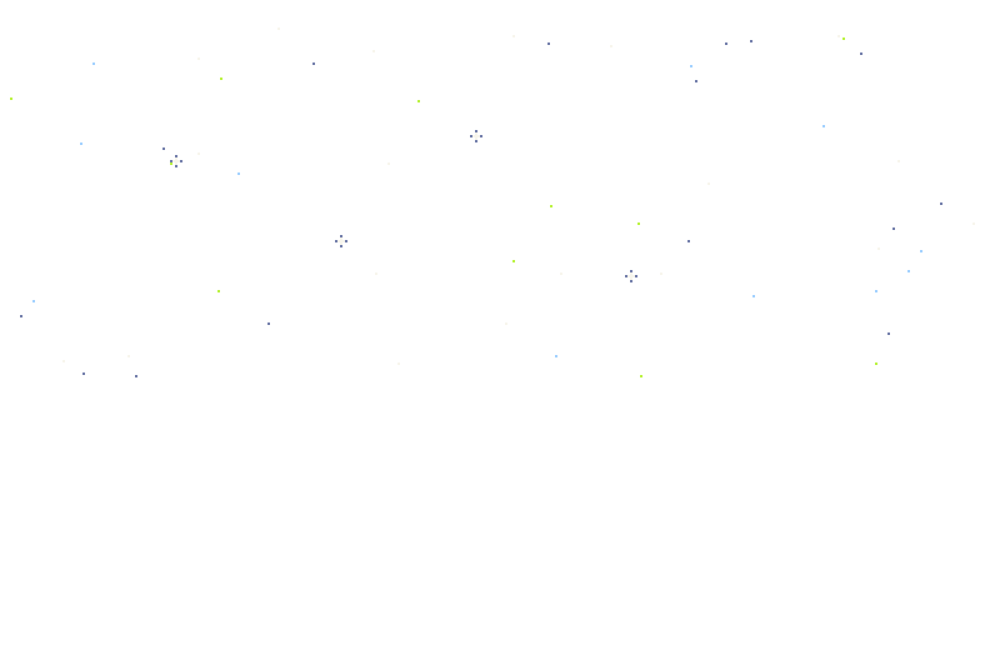
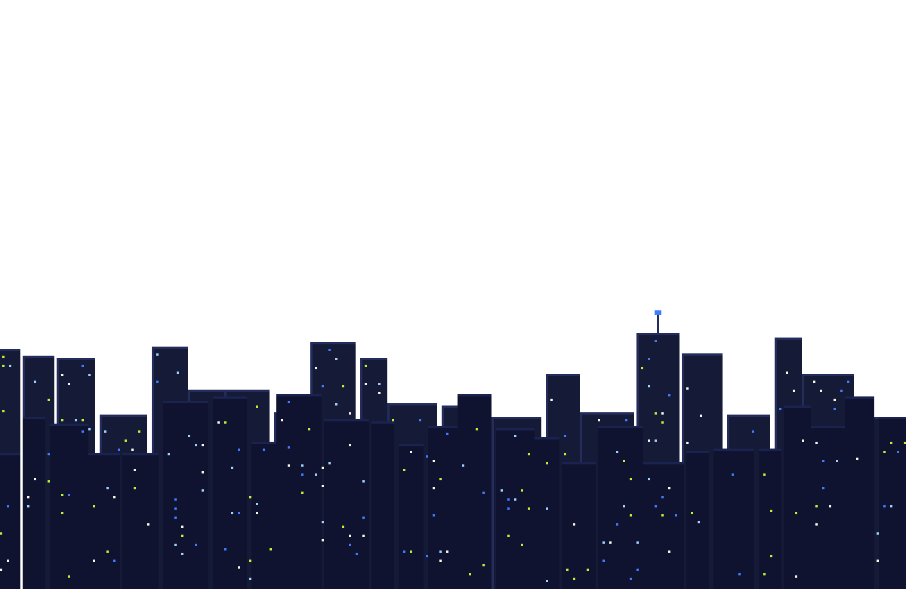
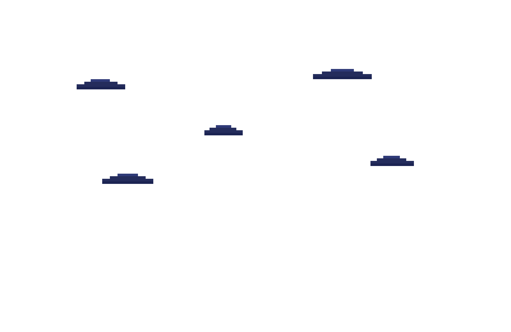
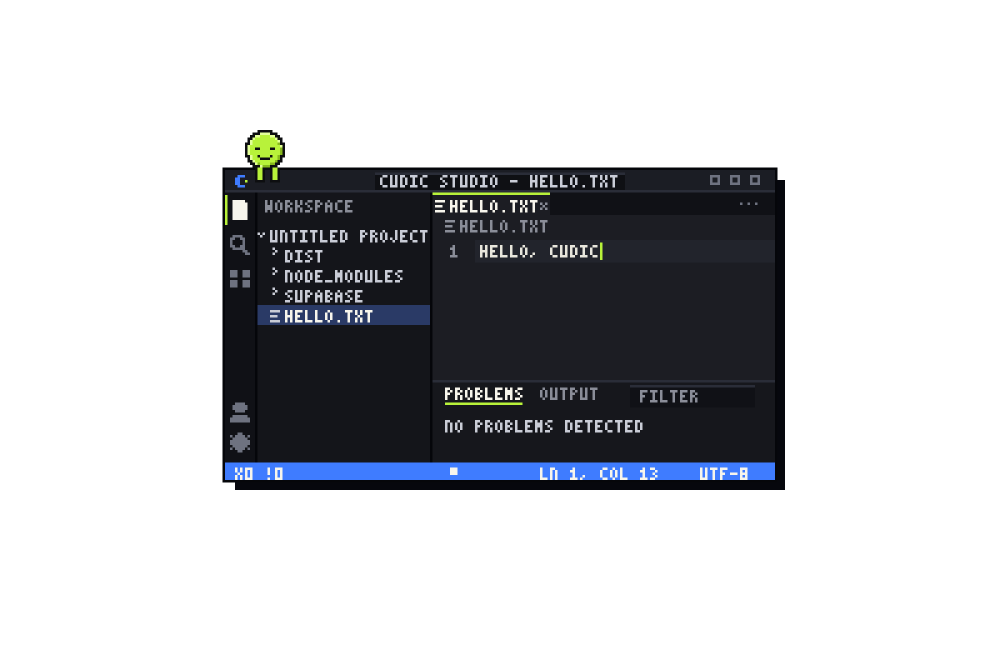
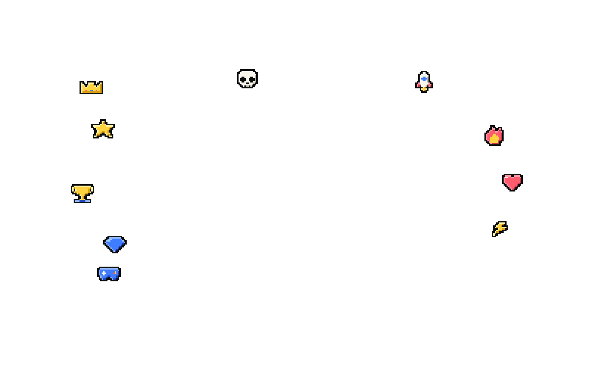
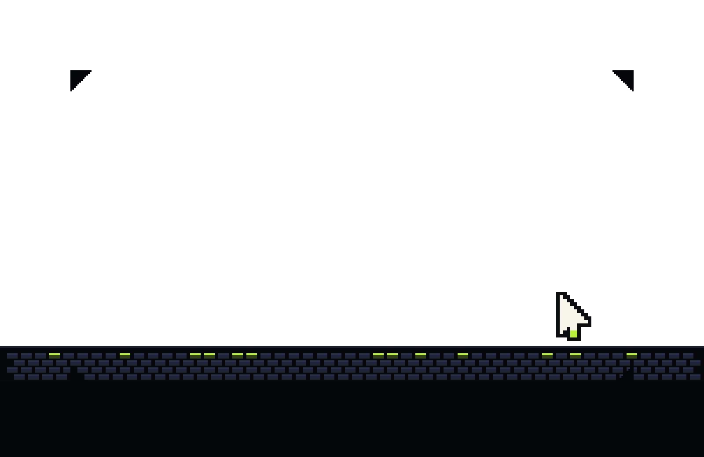

# Cudic Studio Parallax (pixel art)

A 7-layer pixel-art scene of the Cudic Studio: activity bar, explorer, editor, problems panel and status bar, floating in a night city.
The visible window is **320x180 art pixels** (16:9). Each layer is **400x260** with 40 pixels of overscan on every side, so parallax never reveals an edge. Every export is a whole-number scale of that grid, so it stays crisp.

```
cudic-studio-parallax/
  README.md               this guide
  preview.png             composite preview of the visible window (1280x720)
  preview-full-canvas.png the full 400x260 canvas, to show the overscan
  layers.json             depth, z-order and notes for every layer
  layers/
    svg/                  7 layer SVGs + studio-composite.svg (animated with CSS inside the file)
    png/{1x,2x,4x}/       the same layers as PNG (400x260, 800x520, 1600x1040) + studio-composite.png
  mascot/                 9 mascot faces, svg and png (64, 128)
  demo/index.html         interactive demo, one file, no dependencies
  snippets/               parallax.css, parallax.js, ParallaxStudio.jsx
```

## Layers (back to front)
| z | file | depth | what it is | alive |
|---|------|-------|------------|-------|
| 1 | 01-sky | 0.00 | night gradient with dithered bands, moon | static |
| 2 | 02-stars | 0.03 | stars and sparkles | twinkle |
| 3 | 03-skyline | 0.06 | code city with lit windows, antenna | antenna light blinks |
| 4 | 04-clouds | 0.10 | pixel clouds | drift |
| 5 | 05-studio | 0.18 | the Studio window and mascot | caret blink, status pulse, mascot blink and swinging legs |
| 6 | 06-floaters | 0.32 | star, fire, gem, bolt, rocket, crown, trophy, gamepad, heart, skull | bobbing |
| 7 | 07-foreground | 0.65 | keyboard strip, corner frame, cursor | cursor follows the pointer in the demo |

**depth** is how far a layer moves. `0` stays put, `1` would move by the full `strength`. Nearer layers move more.

## Quick start (HTML, 2 minutes)
```html
<link rel="stylesheet" href="snippets/parallax.css">
<div class="px-stage" id="stage">
  
  
  
  
  
  
  
</div>
<script type="module">
  import { parallax } from "./snippets/parallax.js";
  parallax(document.getElementById("stage"), { strength: 24 });
</script>
```
Use the **SVG** layers instead of PNG when you want the built-in animation (blink, twinkle, bob, drift). SVG in an `` still animates. If you need to script the contents (typing, clicks), inline the SVG, as `demo/index.html` does.

## Options
| option | default | effect |
|--------|---------|--------|
| strength | 24 | max shift in art pixels at depth 1. Try 12 for subtle, 40 for dramatic |
| ease | 0.08 | smoothing, from 0.02 (floaty) to 0.3 (snappy) |
| snap | true | moves layers in whole art pixels for a stepped, pixel-true look. Set false for silky motion |
| idle | true | gentle breathing motion after 3s without input, so the scene never goes dead |

Every layer has **40 art pixels of overscan on all four sides** (canvas 400x260, visible window 320x180), so edges never show. `strength x depth` must stay under 40: the default 24 x 0.65 = 15.6, and you can push strength to about 55 safely. Keep `pointer-events:none` on layers so clicks pass through.

## Scroll parallax instead of pointer
```js
addEventListener("scroll", () => {
  const y = scrollY / innerHeight;                       // 0 at top
  for (const l of layers) l.style.transform = `translateY(${-y * 60 * l.dataset.depth}px)`;
}, { passive: true });
```

## React
Copy `snippets/ParallaxStudio.jsx` and `snippets/parallax.js`, then `<ParallaxStudio base="/layers/png/4x" />`.

## Game engines
Use the 4x PNGs (or 1x with scaling) with **nearest / point filtering** and no mipmaps.
| engine | how |
|--------|-----|
| Godot | `ParallaxBackground` with one `ParallaxLayer` per file. `motion_scale = Vector2(1-depth, 1-depth)` for scroll, texture filter Nearest |
| Unity | one SpriteRenderer per layer, Filter Mode Point, Pixels Per Unit 4 (4x files). Move each by `-camera.x * depth` |
| Phaser | `this.add.image(...).setScrollFactor(depth)`; set `pixelArt: true` in the game config |

## Animation hooks in the SVGs
Every moving part is a class or id, so you can restyle or retime it in CSS.
| hook | where | what |
|------|-------|------|
| `.tw1` `.tw2` | stars, skyline | twinkle, two alternating groups |
| `.cl` | clouds | drift (change `animation-duration` per cloud) |
| `#caret` `.caret` | studio | blinking text cursor |
| `#typed` | studio | editor text (replace the rects, or redraw with the pixel font) |
| `#st-pos` | studio | `ln 1, col N` in the status bar |
| `.acc` `.acct` | studio | status bar background and text. Set `--acc` and `--acct` to recolor |
| `.pulse` | studio | status bar live dot |
| `#face-*` `.mas` | studio | 9 mascot faces (only `face-smile` visible by default), swinging legs, `#blink` |
| `.bob` `#f-*` | floaters | bobbing icons, each with its own delay |
| `.jump` | any | one-shot hop. Add the class, remove it after 500ms |
| `#fgcur` | foreground | pixel cursor. Move its parent `<g transform>` to follow the pointer |

Animations use `steps()` so motion lands on whole pixels. `prefers-reduced-motion` turns them all off.

## What the demo wires up
- Pointer, touch drag and device tilt move the layers. Idle breathing kicks in after 3 seconds.
- Click the **editor** to type a phrase, or just type on your keyboard. Backspace works too. The status bar column updates.
- Click the **mascot** to change its face and make it speak. Click any **floating icon** to make it hop and burst.
- Hover and click **files** in the explorer to highlight, select and toggle chevrons.
- Click the **status bar** to flip it between blue and lime.
- Every click throws pixel sparks. A shooting star crosses the sky every few seconds. The foreground cursor trails your pointer.

## Tips
- Keep PNGs on whole-number scales (1x, 2x, 4x). Set `image-rendering: pixelated` for any other size.
- Fonts in the scene are a 3x5 pixel font drawn from rectangles, so it never blurs. Characters available: a-z, 0-9 and `. _ - : / , ! ? <`.
- Palette: ink `#0d0e10`, cream `#f7f5ec`, blue `#3f7cff`, lime `#b8f23a`, sky `#9fd0ff`.
- Performance: only `transform` is animated, so the scene is cheap. Avoid putting `filter` or `box-shadow` on the layers.
